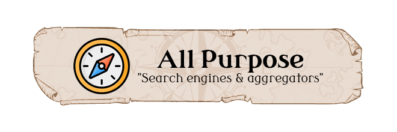

(

### **🧭 ➜ [Megathread](https://www.reddit.com/r/Piracy/wiki/megathread/)/ All Purpose**

❕ ➜ Quick reminder

+ ✔️ All links have been reviewed and approved by moderators, but proceed with caution.

+ 👍🏻 Rather having an enormous variety, our [Megathread](https://www.reddit.com/r/Piracy/wiki/megathread/)provides only the finest options.

+ 🐐 [GOAT](https://www.urbandictionary.com/define.php?term=goat)status = Highly regarded by the pirate community.
 

 

### **📑 ➜ Direct Downloads**

🐐 [Internet Archive](https://archive.org/)
+ Millions of free books, films, songs, and more are available at this nonprofit library.
+ [URL Safety Results](https://www.urlvoid.com/scan/archive.org/)

🔗 [DirtyWarez/94fbrdl](https://94fbrdl.com/) • Sign Up

+ Fantastic community that host a wide variety of media content across almost all genres.
+ [URL Safety Results](https://www.urlvoid.com/scan/94fbrdl.com/)

🔗 [Meawfy](https://meawfy.com/)

+ Discover Mega.nz files instantly and access over 9 million indexed items.
+ [URL Safety Results](https://www.urlvoid.com/scan/meawfy.com/)

🔗 [PiraChest](https://justrun.is-a.dev/pirachest/)

+ An all in one downloader, streaming, discovery app for many of your favorite media, made with efficiency and customization in mind.
+ [URL Safety Results](https://www.urlvoid.com/scan/justrun.is-a.dev/pirachest/)

🔗 [Scnlog](https://scnlog.me/)

+ Generic database including various types of media content, with a bit more emphasis on music.
+ [URL Safety Results](https://www.urlvoid.com/scan/scnlog.me/)
 
🔗 [SoftArchive](https://softarchive.is)/ [2](https://sastatus.com/)

+ Scene website recognised for new releases of software, games, music, movies, and eBooks.
+ [URL Safety Results](https://www.urlvoid.com/scan/softarchive.is/)

🔗 [WarezBook](https://www.warezbook.org/)• Sign Up

+ Cleanly designed forum with an online source of movies, software, games, and music.
+ [URL Safety Results](https://www.urlvoid.com/scan/warezbook.org/)
 

 

### **📑 ➜ Torrents**

🐐 [RuTracker](https://rutracker.org/forum/index.php)• Russian UI

+ Features a wide genre library, robust seeding, and is known as the most comprehensive public tracker.
+ **Sign up to use the search function**.
+ [URL Safety Results](https://www.urlvoid.com/scan/rutracker.org/)

🧲 [1337x](https://1337x.to/) / [2](https://1337x-status.org/)➜ [Note](https://rentry.co/megathread-1337x)

+ Super hub for renowned repackers, crackers, and a vast collection of torrent files.
+ [URL Safety Results](https://www.urlvoid.com/scan/1337x.to/)

🧲 [Bitsearch](https://bitsearch.to/)

+ Advanced search engine that gathers torrent metadata, providing file titles, sizes, and magnet links.
+ [URL Safety Results](https://www.urlvoid.com/scan/bitsearch.to/)

🧲 [BT4G](https://bt4gprx.com/)

+ Making torrent finding and downloading easy for everyone, this torrent search engine uses DHT.
+ [URL Safety Results](https://www.urlvoid.com/scan/bt4gprx.com/)

🧲 [EXT Torrents](https://search.extto.com/)/ [2](https://extranet.torrentbay.st/)

+ Versatile magnet search engine for rapid downloads in diverse media genres.
+ [URL Safety Results](https://www.urlvoid.com/scan/extto.com/)

🧲 [FileMood](https://filemood.com/)

+ Powerful search engine that continuously scans, indexes, and catalogs files available.
+ [URL Safety Results](https://www.urlvoid.com/scan/filemood.com/)

🧲 [Knaben Database](https://knaben.eu/)

+ Realm of web and linux mastery through the evolution of impressive multi-search indexing tool.
+ [URL Safety Results](https://www.urlvoid.com/scan/knaben.eu/)

🧲 [LimeTorrents](https://www.limetorrents.lol/)

+ File-sharing service providing a range of content including music, video, and software files.
+ [URL Safety Results](https://www.urlvoid.com/scan/limetorrents.lol/)

🧲 [NNM-Club](https://nnmclub.to/)• Russian UI

+ Semi-private torrent tracker offers free access to movies, TV shows, music, and software.
+ [URL Safety Results](https://www.urlvoid.com/scan/nnmclub.to/)

🧲 [PiraChest](https://justrun.is-a.dev/pirachest/)

+ An all in one downloader, streaming, discovery app for many of your favorite media, made with efficiency and customization in mind.
+ [URL Safety Results](https://www.urlvoid.com/scan/justrun.is-a.dev/pirachest/)

🧲 [Rustorka](https://rustorka.com/forum/index.php)• Russian UI
+ Prominent warez forum with news, discussions, torrents, and magnet links for all media.
+ [URL Safety Results](https://www.urlvoid.com/scan/rustorka.com/)

🧲 [RUTOR](https://rutor.info/) / [2](https://rutor.is/)• Russian UI
+ Big content library, intuitive interface, and reliability, with a wide array of media.
+ [URL Safety Results](https://www.urlvoid.com/scan/rutor.info/)

🧲 [The Torrent Database](https://developify.ca/)

+ Sizable database offers an extensive catalog of media, all well-seeded for smooth downloads.
+ [URL Safety Results](https://www.urlvoid.com/scan/developify.ca/)

🧲 [Torrent Downloads](https://www.torrentdownloads.pro/)

+ Sizable torrent database with an extensive catalog featuring a diverse range of media and well-seeded.
+ [URL Safety Results](https://www.urlvoid.com/scan/torrentdownloads.pro/)

🧲 [TorrentDownload](https://www.torrentdownload.info/)

+ Access the latest torrents for TV shows, movies, music, and games for your enjoyment.
+ [URL Safety Results](https://www.urlvoid.com/scan/torrentdownloads.pro/)

🧲 [TorrentQuest](https://torrentquest.com/)

+ Browse thousands of torrent links for your download to find all sorts of goodies.
+ [URL Safety Results](https://www.urlvoid.com/scan/torrentquest.com/)

🧲 [TorrentLeech](https://www.torrentleech.org/)• Sign Up

+ Invites are often given to users of this exclusive tracker site, offering torrents in all categories.
+ [URL Safety Results](https://www.urlvoid.com/scan/torrentleech.org/)
 

 

### **📑 ➜ Trackers Scene Data**

📒 [PreDB](https://predb.net/) / [2](https://predb.me/)

+ This service displays trending data that has been gathered from numerous online sources.
+ [URL Safety Results](https://www.urlvoid.com/scan/predb.net/)

📒 [Private Trackers Spreadsheet](https://hdvinnie.github.io/Private-Trackers-Spreadsheet/)

+ Very thorough list demonstrating practically every single private tracker used online.
+ [URL Safety Results](https://hdvinnie.github.io/Private-Trackers-Spreadsheet/)

📒 [xREL](https://www.xrel.to/) • German UI

+ Message board where users discuss the newest scene releases, game and movie reviews, and a lot more.
+ [URL Safety Results](https://www.urlvoid.com/scan/xrel.to/)
 

 

#### **📜 ❮ Return to Megathread**

Last revised by [Ashley__09](https://www.reddit.com/user/Ashley__09/) 18 days ago
